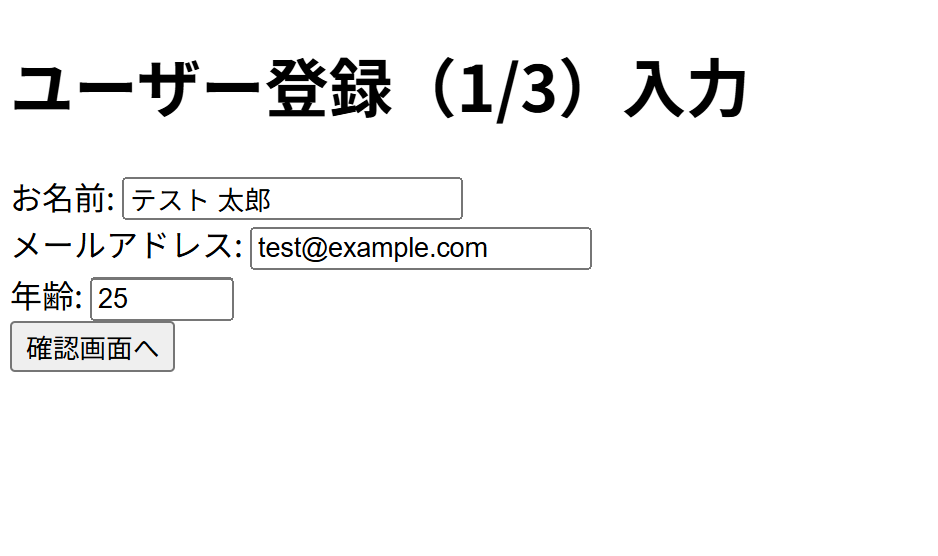
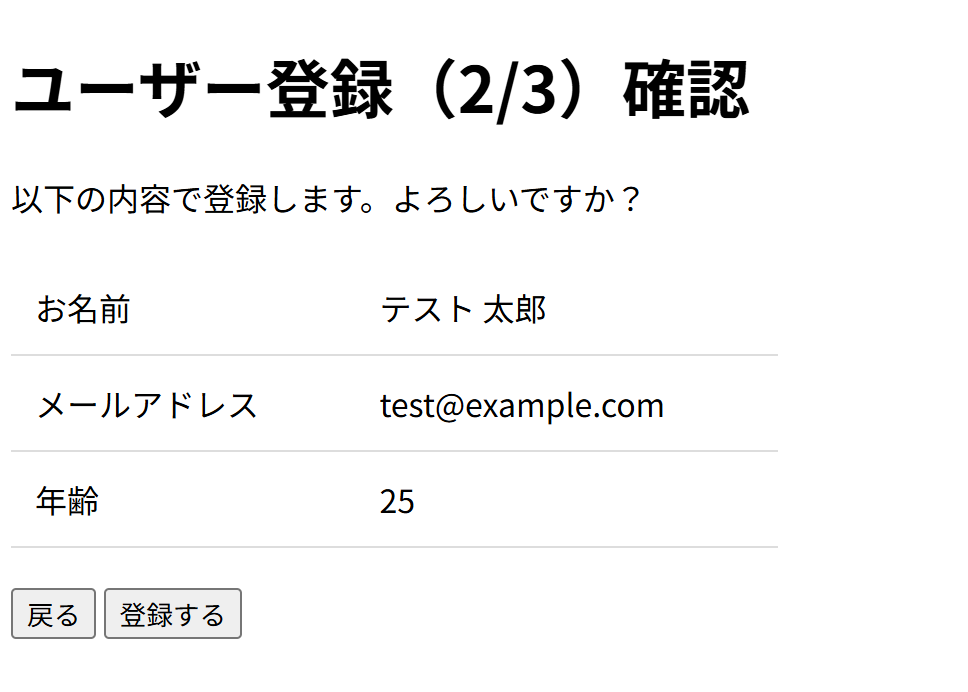
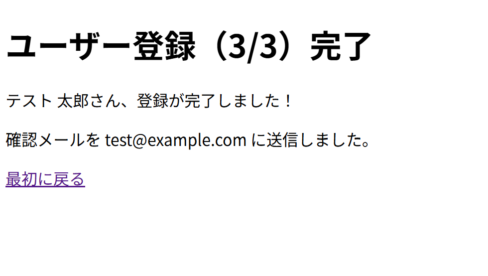

# php-form-practice

## 概要
COACHTECH 教材 Tutorial 7-4「フォームとデータ受け渡し ハンズオン演習」で作成した成果物です。
ユーザーから名前やメールアドレスなどの入力を受け取り、確認画面で入力された情報を表示して、完了画面に遷移するという仕組みを作成しました。

## 使用技術
- PHP 8.2-fpr
- nginx
- HTML5（フォーム要素）

## 学んだこと
- HTMLのformタグで作成したフォームからから受け取った値を、別のphpファイルに共有する方法
- phpが受け取ったユーザーの情報を$_POST連想配列からキーを指定して値を取り出す方法
- htmlspecialchars関数によってXSS対策のためのエスケープ処理を行う方法

## 動作確認
1. php-practiceディレクトリ上でDocker composeによりnginxコンテナとphpコンテナを起動させてネットワークで連携
2. VSCode上でPHPファイルを編集して保存
3. ブラウザで「`http://localhost:8000/7-4-3_hands-on/practice/input.php`」のURLにアクセス
4. ブラウザ上で入力、画面遷移、表示内容を確認
5. VSCodeでの編集を保存+input.phpのリロードで編集内容を確認

## 詰まったポイントと解決方法
- 確認画面で入力された情報を表示する際に、文字列を並べるだけでは分かりにくい  
　┗tableタグで表形式にして表示することで見やすくした
- 確認画面の「戻る」「登録するボタン」が縦に並んでいた  
　┗formタグ内に二つともボタンとして配置し、特別な改行処理などを入れないようにして横に並ぶようにした

## 開発の工夫
- ユーザーから受け取った情報には個人情報が含まれるため、URLパラメータではなくHTTPリクエストの本文内にキーと値の情報を組み込めるPOST形式を採用した
- inputタグで作成した各入力フォームにはlabelタグをつけることでアクセシビリティを向上させた
- ユーザーから受け取った文字列をHTML出力する場合はXSS対策としてエスケープ処理を行った

## 動作確認のスクリーンショット

